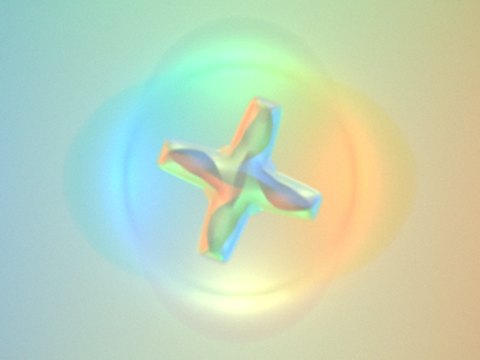

A GelSight-type tactile sensor, simulated in your browser. Press the gel with the mouse or a finger, drag to shear it, and switch views to see what the camera records and what can be recovered from it.

<iframe id="tactile-demo" class="demo-frame" src="/demos/tactile-sensor-demo.html" title="Interactive simulation of a GelSight-type tactile sensor"></iframe>

You can also <a href="/demos/tactile-sensor-demo.html">open the demo in its own window</a>. The real sensor I built is described in <a href="/portfolio/portfolio-1/">Building a GelSight-type tactile sensor</a>.

## Physics-based simulator

  <a class="demo-card" href="/demos/gelsight-sim.html">
    
    
      Research tool · English / 中文
      A more physical simulator, with training-data export
      A colour-only sensor (no markers) in which each physical effect can be switched on and off and compared: elastic contact in a thin gel layer, coating reflectance and shadows, LED falloff and spectral crosstalk, light trapping and refraction in the gel, and camera noise. It exports images paired with height and normal maps, as training data for a network that replaces the lookup table.
      Open the simulator &rarr;
    
  </a>

